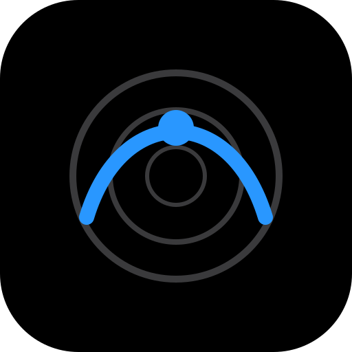
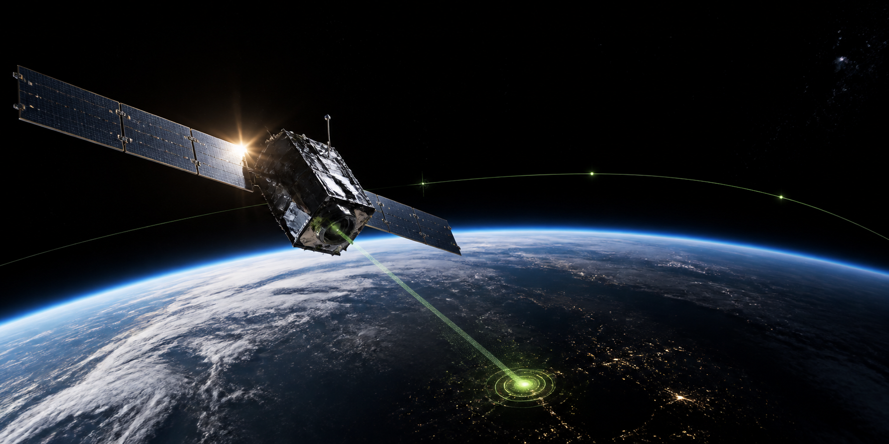

<p align="center">
  
</p>

<h1 align="center">SkyPass</h1>

<p align="center">
  <strong>Weather-aware satellite pass prediction, visibility analysis, and observation scheduling,<br>with learned cloud nowcasting and brightness prediction.</strong>
</p>

<p align="center">
  Turn public orbital data and weather forecasts into a practical, conflict-free night of observations.
</p>

<p align="center">
  
  
  
  
</p>



## Why SkyPass?

Finding a satellite pass is only the beginning. A useful observing plan also
needs to answer whether the satellite is illuminated, whether the observer is
under a dark enough sky, whether clouds are likely to block the view, and which
passes should win when observation windows overlap.

SkyPass combines those decisions in one reproducible pipeline:

```text
Orbital elements -> SGP4 propagation -> Pass extraction -> Visibility scoring
                 -> Weather calibration -> Exact scheduling -> Observation plan
```

The result is available as a command-line tool, a Python library, and a focused
React planning console.

## Features

- **Accurate pass prediction** using SGP4, TEME-to-ECEF conversion, WGS-84
  topocentric geometry, and sub-second crossing refinement.
- **Optical visibility analysis** with Earth-shadow geometry, observer twilight,
  atmospheric refraction, phase angle, and apparent magnitude.
- **Weather-aware scoring** using Open-Meteo forecasts calibrated against ERA5
  reanalysis instead of trusting raw cloud percentages blindly.
- **Conflict-free scheduling** with exact dynamic programs for weighted interval
  scheduling, nightly capacity limits, setup gaps, and multi-night budgets.
- **Reproducible orbital inputs** through dated TLE archives and configurable
  element-age rejection.
- **Practical exports** to terminal output, CSV, JSON, and iCalendar (`.ics`).
- **Observation console** with night ranking, pass timelines, weather context,
  decision explanations, a field run sheet, and a live countdown mode.
- **Learned components (v2, optional)**: a U-Net that reads the cloud fraction
  from a whole-sky camera image as a sub-hourly nowcast, and gradient-boosted
  trees that predict a satellite's apparent magnitude from pass geometry,
  trained on measured magnitudes from the IAU CPS SCORE repository.

## Quick Start

SkyPass requires Python 3.9 or newer. The core data sources, CelesTrak and
Open-Meteo, do not require API keys.

```bash
git clone https://github.com/rohithprem18/skypass.git
cd SkyPass

python -m venv .venv
python -m pip install -e ".[experiments]"
```

Activate the virtual environment, then fetch fresh orbital elements and build a
seven-day plan:

```bash
python -m skypass fetch
python -m skypass stations
python -m skypass plan --days 7 --ics results/plan.ics
```

Plan for a custom observing site and export every supported format:

```bash
python -m skypass plan \
  --lat 12.92 --lon 80.12 --alt 30 --name "My Station" \
  --days 7 --mask 15 --gap 10 \
  --csv results/plan.csv \
  --json results/plan.json \
  --ics results/plan.ics
```

Useful options include:

| Option | Purpose |
|---|---|
| `--radio` | Keep radio passes without optical illumination or magnitude constraints |
| `--no-weather` | Run a weather-blind comparison |
| `--sat ISS,NOAA` | Filter the catalogue by satellite name |
| `--mask 15` | Set the minimum elevation in degrees |
| `--gap 10` | Reserve setup time between observations in minutes |
| `--w-elev 0.7` | Increase elevation's contribution to the pass score |
| `--capacity 3` | At most 3 observations per night (a fixed nightly quota) |
| `--budget 30` | At most 30 observations over the window, so cloudy nights can be skipped |
| `--learned-brightness` | Predict magnitudes with the learned model instead of the diffuse sphere |
| `--sky-image sky.jpg` | Use a whole-sky camera image as the cloud nowcast for the next hour |

### Learned components

The learned models are optional and need the `[ml]` extra (adds NumPy, pandas,
scikit-learn, Pillow and PyTorch). Their training data are downloaded from the
providers by the experiment scripts and are not redistributed here; the scripts
also save the trained models under `cache/ml/models/`.

```bash
python -m pip install -e ".[ml,experiments]"
python experiments/exp11_brightness.py      # downloads SCORE, trains the brightness model
python experiments/exp10_cloudcam.py        # downloads WSISEG, trains the cloud U-Net
python -m skypass plan --budget 30 --learned-brightness --sky-image sky.jpg
```

The brightness model is much better than the sphere for satellites it has not
seen, but it drifts as satellite designs change, so retrain it regularly; the
sphere stays the default.

Run `python -m skypass fetch` regularly. CelesTrak serves current elements, so
the dated local archive is what keeps historical predictions reproducible.

## Web App

The web interface uses the same Python planning engine as the CLI. Build the
React application and start the included server:

```bash
python -m skypass fetch

cd webapp/ui
npm ci
npm run build

cd ../..
python webapp/server.py
```

Open [http://localhost:8000](http://localhost:8000).

For frontend development, run the backend and Vite in separate terminals:

```bash
# Terminal 1
python webapp/server.py

# Terminal 2
cd webapp/ui
npm run dev
```

Vite serves the UI at [http://localhost:5173](http://localhost:5173) and proxies
`/api` requests to the Python server on port `8000`.

### Planning Views

| View | Main question |
|---|---|
| **Overview** | Is tonight worth observing, and what is the best pass? |
| **Planner** | Which night should I choose, and where do its passes fit? |
| **Passes** | Which candidates cleared the visibility filters? |
| **Weather** | How do cloud conditions change through the observing window? |
| **Schedule** | What is the final field-ready run sheet? |
| **Analysis** | What did the validation experiments find? |
| **Experiments** | How was each scientific claim tested? |

## How It Works

| Stage | Implementation |
|---|---|
| Element sets | Fetches and archives TLEs from CelesTrak, optionally compares AMSAT data, validates checksums, and rejects stale epochs |
| Propagation | Uses the reference `sgp4` core with TEME-to-ECEF and WGS-84 topocentric look angles |
| Pass extraction | Brackets horizon crossings coarsely, then refines them by bisection to 0.1 seconds |
| Visibility | Models conical Earth shadow, twilight, refraction, phase angle, and Lambertian-sphere brightness |
| Weather | Retrieves Open-Meteo forecasts and calibrates cloud probabilities against ERA5 |
| Learned (optional) | U-Net cloud nowcast from a whole-sky image; gradient-boosted magnitude model trained on SCORE |
| Scheduling | Solves weighted interval, nightly-capacity, and multi-night-budget problems with exact dynamic programming |
| Output | Produces a readable timetable plus CSV, JSON, and `.ics` files |

The fast pass finder used **23.7x fewer propagator calls** than a one-second dense
scan in the accompanying experiments. Element-set age is treated as a first-class
quality constraint because timing error grows quickly as a TLE becomes stale.

## Python API

```python
from skypass import GROUND_STATIONS, plan

result = plan(GROUND_STATIONS["chennai"], days=7)

print(result.summary()["funnel"])
for observation in result.schedule.selected:
    print(
        observation.name,
        observation.tca,
        f"{observation.el_max_deg:.1f} deg",
        observation.detail.get("cloud"),
    )
```

## Research and Reproducibility

This repository is the companion implementation for:

> **SkyPass: A Machine Learning and Exact Optimisation Framework for
> Weather-Aware Satellite Pass Scheduling at Small Ground Stations**<br>
> Rohith Prem S and Dr. R. Selvakumar<br>
> Saveetha Engineering College, Chennai, India

The experiments are organized around eleven questions:

| Script | Question |
|---|---|
| `exp1_accuracy` | Does the fast pass finder match dense sampling and Skyfield? |
| `exp2_elements` | How old are operational element sets, and how much timing uncertainty do they add? |
| `exp3_forecast` | How much skill does the cloud forecast retain across planning lead times? |
| `exp4_weather_value` | When does weather-aware scheduling improve realized observations? |
| `exp5_scheduling` | Is the exact dynamic program optimal, and what does a metaheuristic lose? |
| `exp6_pipeline` | How does the full pipeline scale and respond to score weights? |
| `exp7_structure` | Why does weather help between nights more than within one night? |
| `exp8_tle_age` | How quickly does prediction quality decay with element-set age? |
| `exp9_bootstrap` | How certain are the weather gains, resampling whole stations? |
| `exp10_cloudcam` | Can a learned model read cloud cover from whole-sky images? |
| `exp11_brightness` | Can a learned model predict satellite brightness better than the sphere? |

Generate paper figures and tables from the saved experiment outputs:

```bash
python experiments/make_figures.py
python experiments/make_tables.py
```

Every reported paper value is generated from `results/*.json`. Historical
Space-Track analysis is optional and requires a free account; setup instructions
are in [docs/spacetrack-setup.md](docs/spacetrack-setup.md).

> [!IMPORTANT]
> Pin the Open-Meteo archive request to `models=era5`. The default best-match
> series can overlap with archived forecast data and produce misleadingly perfect
> verification scores.

## Repository Layout

```text
skypass/          Core propagation, geometry, scoring, weather, and scheduling
skypass/ml/       Optional learned components: cloud nowcast, brightness model
experiments/      Eleven validation experiments, figure/table/diagram generators
tests/            Deterministic unit tests; no network required
results/          Experiment outputs consumed by the paper
figures/          Generated scientific figures
generated/        Result macros and tables built from results/ by make_tables.py
final_paper/      Submission manuscripts: ieee/ (IEEE conference) and springer/
                  (SN Computer Science), plus reports/ from the evidence audit
tle_archive/      Dated orbital-element archives
webapp/           Python server, React UI, and dependency-free fallback build
docs/             Setup notes and project assets
```

Default paths are anchored in `skypass/paths.py`, so commands launched from a
subdirectory still share the same caches, archives, and result directories.

## Testing

```bash
python -m pytest tests -q
```

The suite covers coordinate transforms, shadow geometry, photometry, TLE parsing,
pass extraction, weather calibration, all three schedulers, the planner modes,
the nowcast hook and the learned components (skipped if the `[ml]` extra is
absent). Scheduling tests
compare optimized solutions against exhaustive search over randomized instances.

The frontend can be checked independently:

```bash
cd webapp/ui
npm run typecheck
npm run build
```

## Data Sources

- [CelesTrak](https://celestrak.org/) for current GP orbital elements.
- [AMSAT](https://www.amsat.org/tle/) for an independent element-provider comparison.
- [Open-Meteo](https://open-meteo.com/) for operational forecasts, archived
  forecasts, and ERA5 reanalysis.
- [Space-Track](https://www.space-track.org/) for optional historical element sets.
- [IAU CPS SCORE](https://score.cps.iau.org/) for measured satellite magnitudes
  (CC-BY 4.0), used to train the brightness model.
- [WSISEG](https://github.com/CV-Application/WSISEG-Database) whole-sky images
  with cloud labels (Xie et al., 2020), used to train the cloud U-Net.

This research made use of data and/or services provided by the International
Astronomical Union Centre for the Protection of the Dark and Quiet Sky (IAU CPS)
SatHub. The development of SCORE has been supported by the National Science
Foundation (NSF) under grant number: AST 2332736. SCORE is hosted at the NSF
NOIRLab. Any opinions, findings, and conclusions or recommendations expressed in
this material are those of the author(s) and do not necessarily reflect the
views of the NSF NOIRLab, the SKAO, the IAU, or any host or member institution of
the IAU CPS.

Space-Track credentials are read from environment variables or a git-ignored
local file and are never written to generated outputs.

## Responsible Use

SkyPass consumes publicly released orbital elements and public weather data. It
is intended for education, amateur radio, civil optical observation, and
reproducible research.

## Authors

- **Rohith Prem S** - Department of Computer Science and Engineering, Saveetha
  Engineering College - <rohithprem91@gmail.com>
- **Dr. R. Selvakumar** - Department of Artificial Intelligence and Machine
  Learning, Saveetha Engineering College - <selvakumarr@saveetha.ac.in>

## License

Released under the [MIT License](LICENSE).
