<p align="center">
  
</p>

<p align="center">
  <strong>Weather-aware satellite pass prediction, visibility analysis and observation scheduling,<br>with learned cloud nowcasting and brightness prediction.</strong>
</p>

<p align="center">
  
  
  
  
  
</p>

<p align="center">
  <a href="#demo"><b>Demo</b></a> &nbsp;&middot;&nbsp;
  <a href="#features"><b>Features</b></a> &nbsp;&middot;&nbsp;
  <a href="#quick-start"><b>Quick Start</b></a> &nbsp;&middot;&nbsp;
  <a href="#web-console"><b>Web Console</b></a> &nbsp;&middot;&nbsp;
  <a href="#how-it-works"><b>How It Works</b></a> &nbsp;&middot;&nbsp;
  <a href="#research"><b>Research</b></a>
</p>

<a id="demo"></a>

##  See it plan a night

<p align="center">
  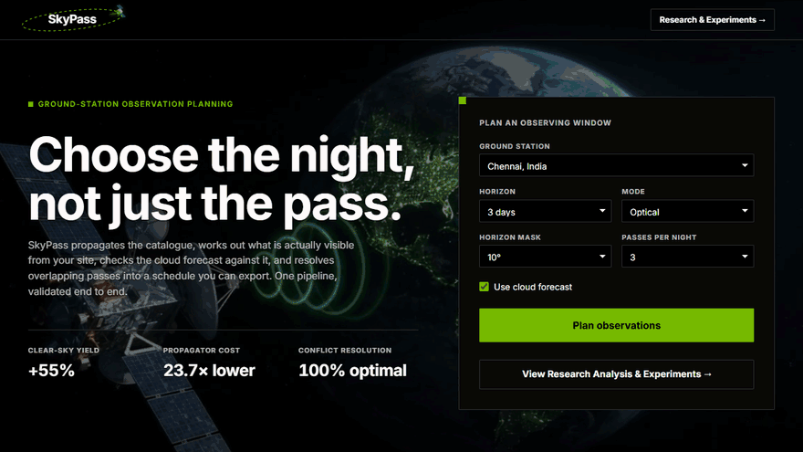
</p>

<p align="center"><sub>Recorded from the real console on 6 November 2026. Under 90% forecast cloud, SkyPass advises against observing and points to a clearer night.</sub></p>

<p align="center">
  
</p>


##  The problem SkyPass solves

<table>
<tr>
<td width="210" align="center">
  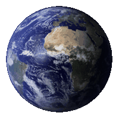
</td>
<td>

Finding a satellite pass is only the beginning. A useful plan also has to answer
whether the satellite is illuminated, whether the observer is under a dark enough
sky, whether cloud is likely to block the view, and which pass should win when
two windows overlap.

SkyPass joins those decisions in one reproducible pipeline. It turns public
orbital data and public weather forecasts into a practical, conflict-free night
of observations, available as a **command-line tool**, a **Python library** and a
**React planning console**.

</td>
</tr>
</table>

<p align="center">
  
</p>

<a id="features"></a>

##  Features

<table>
<tr>
<td width="33%" valign="top">
<br>
<b>Accurate pass prediction</b><br>
<sub>SGP4, TEME-to-ECEF conversion, WGS-84 topocentric geometry and sub-second crossing refinement.</sub>
</td>
<td width="33%" valign="top">
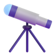<br>
<b>Optical visibility analysis</b><br>
<sub>Earth-shadow geometry, observer twilight, atmospheric refraction, phase angle and apparent magnitude.</sub>
</td>
<td width="33%" valign="top">
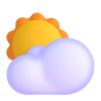<br>
<b>Weather-aware scoring</b><br>
<sub>Open-Meteo forecasts calibrated against ERA5 reanalysis, rather than raw cloud percentages taken at face value.</sub>
</td>
</tr>
<tr>
<td valign="top">
<br>
<b>Conflict-free scheduling</b><br>
<sub>Exact dynamic programs for weighted interval scheduling, nightly capacity, setup gaps and multi-night budgets.</sub>
</td>
<td valign="top">
<br>
<b>Reproducible inputs</b><br>
<sub>Dated TLE archives and configurable rejection of stale element sets.</sub>
</td>
<td valign="top">
<br>
<b>Practical exports</b><br>
<sub>Terminal timetable, CSV, JSON and iCalendar (<code>.ics</code>) files.</sub>
</td>
</tr>
<tr>
<td valign="top">
<br>
<b>Observation console</b><br>
<sub>Night ranking, pass timelines, weather context, decision explanations, a field run sheet and a live countdown.</sub>
</td>
<td valign="top">
<br>
<b>Learned sky nowcast (optional)</b><br>
<sub>A pixel gradient-boosted segmenter reads cloud fraction from a whole-sky image for the next hour. A U-Net is included for comparison.</sub>
</td>
<td valign="top">
<br>
<b>Learned brightness (optional)</b><br>
<sub>Gradient-boosted trees predict apparent magnitude, trained on measured magnitudes from IAU CPS SCORE.</sub>
</td>
</tr>
</table>

<a id="quick-start"></a>

##  Quick Start

SkyPass requires Python 3.9 or newer. The core data sources, CelesTrak and
Open-Meteo, do not require API keys.

```bash
git clone https://github.com/rohithprem18/skypass.git
cd skypass

python -m venv .venv
python -m pip install -e ".[experiments]"
```

Activate the virtual environment, then fetch fresh orbital elements and build a
seven-day plan:

```bash
python -m skypass fetch
python -m skypass stations
python -m skypass plan --days 7 --ics results/plan.ics
```

Run `python -m skypass fetch` regularly. CelesTrak serves current elements, so
the dated local archive is what keeps historical predictions reproducible.

<details>
<summary><b>Plan for a custom site and export every format</b></summary>
<br>

```bash
python -m skypass plan \
  --lat 12.92 --lon 80.12 --alt 30 --name "My Station" \
  --days 7 --mask 15 --gap 10 \
  --csv results/plan.csv \
  --json results/plan.json \
  --ics results/plan.ics
```

</details>

<details>
<summary><b>All useful command-line options</b></summary>
<br>

| Option | Purpose |
|---|---|
| `--radio` | Keep radio passes without optical illumination or magnitude constraints |
| `--no-weather` | Run a weather-blind comparison |
| `--sat ISS,NOAA` | Filter the catalogue by satellite name |
| `--mask 15` | Set the minimum elevation in degrees |
| `--gap 10` | Reserve setup time between observations in minutes |
| `--w-elev 0.7` | Increase elevation's contribution to the pass score |
| `--capacity 3` | At most 3 observations per night (a fixed nightly quota) |
| `--budget 30` | At most 30 observations over the window, so cloudy nights can be skipped |
| `--no-calibrate` | Score the raw forecast instead of the calibrated one |
| `--learned-brightness` | Predict magnitudes with the learned model instead of the diffuse sphere |
| `--sky-image sky.jpg` | Use a whole-sky camera image as the cloud nowcast for the next hour |

</details>

<details>
<summary><b>Learned components</b></summary>
<br>

The learned models are optional and need the `[ml]` extra (adds NumPy, pandas,
scikit-learn, Pillow and PyTorch). Their training data are downloaded from the
providers by the experiment scripts and are not redistributed here. The scripts
save the trained models under `cache/ml/models/`.

```bash
python -m pip install -e ".[ml,experiments]"
python experiments/exp11_brightness.py      # downloads SCORE, trains the brightness model
python experiments/exp10_cloudcam.py        # downloads WSISEG, trains the cloud segmenters
python -m skypass plan --budget 30 --learned-brightness --sky-image sky.jpg
```

The brightness model is much better than the sphere for satellites it has not
seen, but it drifts as satellite designs change, so retrain it regularly. The
sphere stays the default.

</details>

<details>
<summary><b>Python API</b></summary>
<br>

```python
from skypass import GROUND_STATIONS, plan

result = plan(GROUND_STATIONS["chennai"], days=7)

print(result.summary()["funnel"])
for observation in result.schedule.selected:
    print(
        observation.name,
        observation.tca,
        f"{observation.el_max_deg:.1f} deg",
        observation.detail.get("cloud"),
    )
```

</details>

<a id="web-console"></a>

##  Web Console

The web interface uses the same Python planning engine as the command line.

<table>
<tr>
<td width="50%">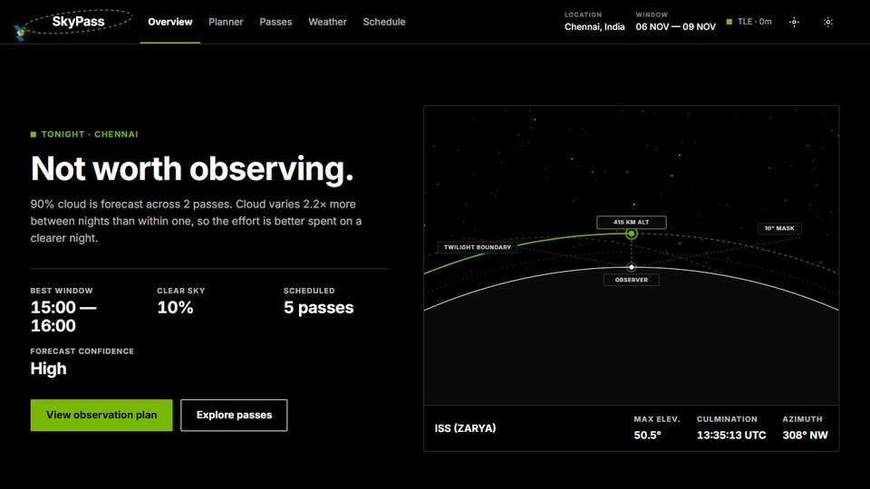<br><b>Overview</b><br><sub>Is tonight worth observing, and what is the best pass?</sub></td>
<td width="50%">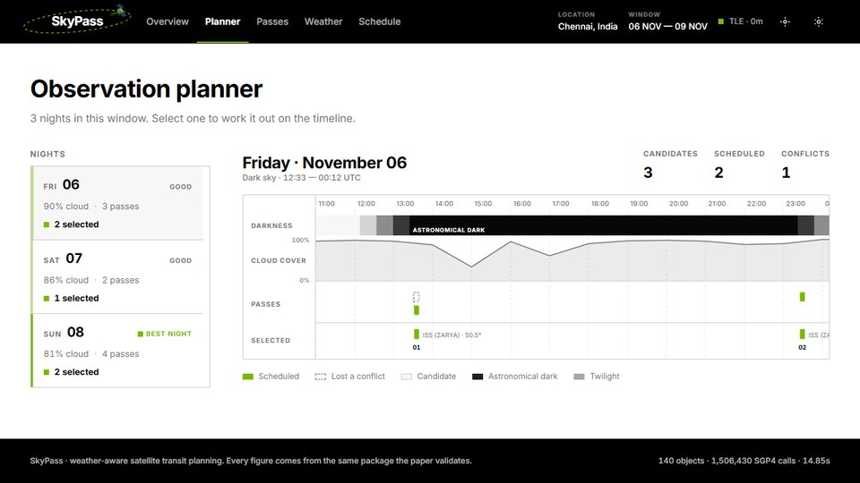<br><b>Planner</b><br><sub>Which night should I choose, and where do its passes fit?</sub></td>
</tr>
<tr>
<td>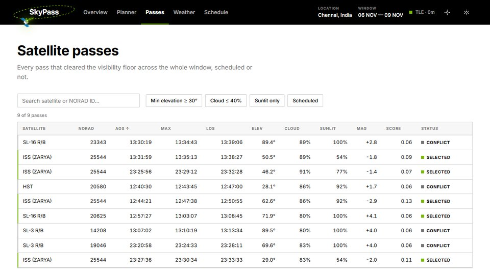<br><b>Passes</b><br><sub>Which candidates cleared the visibility filters?</sub></td>
<td>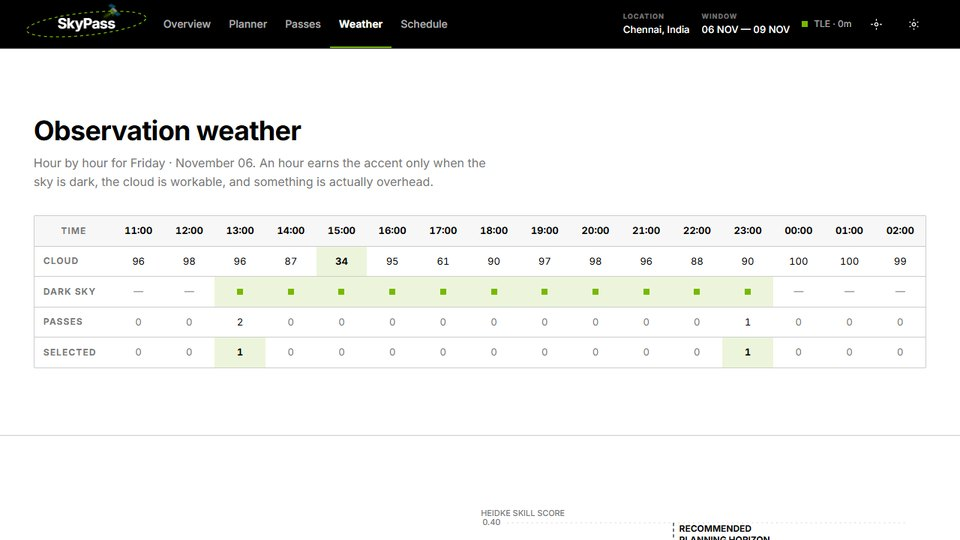<br><b>Weather</b><br><sub>How does cloud change through the observing window?</sub></td>
</tr>
<tr>
<td>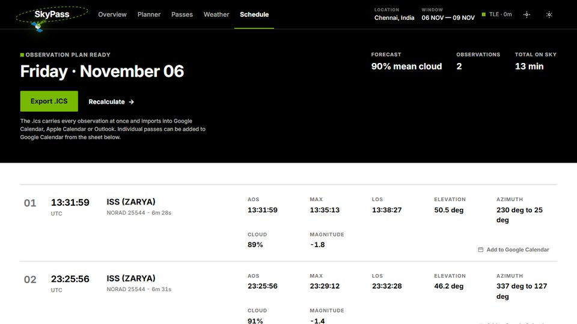<br><b>Schedule</b><br><sub>What is the final field-ready run sheet?</sub></td>
<td>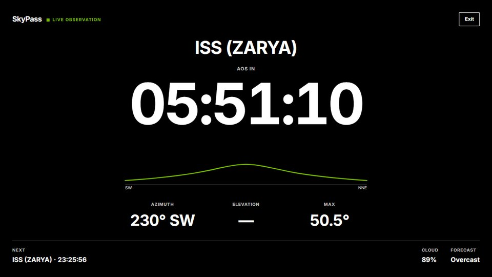<br><b>Live mode</b><br><sub>How long until acquisition, and where do I point?</sub></td>
</tr>
</table>

The **Analysis** and **Experiments** pages present what the validation experiments
found and how each scientific claim was tested.

Build the React application and start the included server:

```bash
python -m skypass fetch

cd webapp/ui
npm ci
npm run build

cd ../..
python webapp/server.py
```

Open [http://localhost:8000](http://localhost:8000).

<details>
<summary><b>Frontend development</b></summary>
<br>

Run the backend and Vite in separate terminals:

```bash
# Terminal 1
python webapp/server.py

# Terminal 2
cd webapp/ui
npm run dev
```

Vite serves the UI at [http://localhost:5173](http://localhost:5173) and proxies
`/api` requests to the Python server on port `8000`.

</details>

<a id="how-it-works"></a>

##  How It Works

<p align="center">
  
</p>

| Stage | Implementation |
|---|---|
| Element sets | Fetches and archives TLEs from CelesTrak, optionally compares AMSAT data, validates checksums and rejects stale epochs |
| Propagation | Uses the reference `sgp4` core with TEME-to-ECEF and WGS-84 topocentric look angles |
| Pass extraction | Brackets horizon crossings coarsely, then refines them by bisection to 0.1 seconds |
| Visibility | Models conical Earth shadow, twilight, refraction, phase angle and Lambertian-sphere brightness |
| Weather | Retrieves Open-Meteo forecasts and calibrates cloud against ERA5 |
| Learned (optional) | Pixel gradient-boosted cloud nowcast from a whole-sky image; gradient-boosted magnitude model trained on SCORE |
| Scheduling | Solves weighted interval, nightly-capacity and multi-night-budget problems with exact dynamic programming |
| Output | Produces a readable timetable plus CSV, JSON and `.ics` files |

The score `S = (w_e f_e + w_d f_d) f_m f_s` is **multiplicative on purpose**: a pass
that is eclipsed, in a bright sky or under overcast must score zero, however good
its geometry. Element-set age is treated as a first-class constraint, because
timing error grows from 0.05 s at one day to 4.3 s at one week and 75.3 s at one
month.

<a id="research"></a>

## 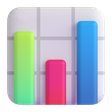 What the research found

<table>
<tr>
<td width="90" align="center"></td>
<td><b>A forecast pays when the planner may skip a night.</b><br>It cannot discriminate well within one night, because cloud is autocorrelated and pass quality varies more. Calibration raises the gain in every regime.</td>
</tr>
</table>

| Observing regime | Expected value | Clear-sky observations |
|---|:---:|:---:|
| Fixed nightly quota | **-1.5%** | **-0.2%** |
| Window budget, half of the quota | **+19.0%** | **+37.6%** |
| Window budget, a quarter of the quota | **+19.2%** | **+55.0%** |

<sub>Gains are against weather-blind planning, pooled over six stations in one season. Station-bootstrap intervals: half budget EV +9.2 to +24.9, clear +3.1 to +80.4; quota intervals include zero. Epoch-correct geometry lowers the half-budget clear gain to +33.2%. The uncalibrated forecast is worse than ignoring weather under the quota only (-9.2% EV).</sub>

<details>
<summary><b>More measured results</b></summary>
<br>

| Area | Result |
|---|---|
| Pass extraction | 99.78% recall against a 1 s dense scan, with 23.7x fewer propagator calls (54.9 M to 2.31 M); 0.055 s mean culmination agreement with Skyfield |
| Exact scheduling | Matched exhaustive search on 100.00% of 2,000 random instances; 100,000 intervals in 285.3 ms; a genetic algorithm reached 99.67% at 38,922x the time |
| Forecast skill | Heidke skill score 0.347 (day 1), 0.289 (day 3), 0.114 (day 7); persistence 0.206 |
| Scale | 635 objects over 7 days gave 12,438 passes in 104.4 s; scheduling took 2.1 ms |
| Sky camera | Cloud-fraction error 27.0 pp (fixed ratio rule), 3.5 pp (tuned rule), 1.2 pp (pixel GBM and U-Net) on WSISEG, blocked 5-fold |
| Brightness | Unseen-satellite MAE 1.86 (sphere), 1.51 (fitted sphere), 0.83 mag (learned); after 2025-07 the learned model ties the fitted sphere (2.00 against 1.99), so the sphere stays the default |

</details>

This repository is the companion implementation for:

> **SkyPass: A Machine Learning and Exact Optimisation Framework for
> Weather-Aware Satellite Pass Scheduling at Small Ground Stations**<br>
> Dr. R. Selvakumar and Rohith Prem S<br>
> Saveetha Engineering College, Chennai, India

<details>
<summary><b>The eleven experiments</b></summary>
<br>

| Script | Question |
|---|---|
| `exp1_accuracy` | Does the fast pass finder match dense sampling and Skyfield? |
| `exp2_elements` | How old are operational element sets, and how much timing uncertainty do they add? |
| `exp3_forecast` | How much skill does the cloud forecast retain across planning lead times? |
| `exp4_weather_value` | When does weather-aware scheduling improve realized observations? |
| `exp5_scheduling` | Is the exact dynamic program optimal, and what does a metaheuristic lose? |
| `exp6_pipeline` | How does the full pipeline scale and respond to score weights? |
| `exp7_structure` | Why does weather help between nights more than within one night? |
| `exp8_tle_age` | How quickly does prediction quality decay with element-set age? |
| `exp9_bootstrap` | How certain are the weather gains, resampling whole stations? |
| `exp10_cloudcam` | Can a learned model read cloud cover from whole-sky images? |
| `exp11_brightness` | Can a learned model predict satellite brightness better than the sphere? |

Generate paper figures and tables from the saved experiment outputs:

```bash
python experiments/make_figures.py
python experiments/make_tables.py
```

Every reported paper value is generated from `results/*.json`. Historical
Space-Track analysis is optional and requires a free account; setup instructions
are in [docs/spacetrack-setup.md](docs/spacetrack-setup.md).

</details>

> [!IMPORTANT]
> Pin the Open-Meteo archive request to `models=era5`. The default best-match
> series can overlap with archived forecast data and produce misleadingly perfect
> verification scores.

##  Testing

```bash
python -m pytest tests -q
```

The 71 deterministic tests need no network. They cover coordinate transforms,
shadow geometry, photometry, TLE parsing, pass extraction, weather calibration,
all three schedulers, the planner modes, the nowcast hook and the learned
components (skipped if the `[ml]` extra is absent). Scheduling tests compare
optimised solutions against exhaustive search over randomised instances.

<details>
<summary><b>Frontend checks and repository layout</b></summary>
<br>

```bash
cd webapp/ui
npm run typecheck
npm run build
```

```text
skypass/          Core propagation, geometry, scoring, weather and scheduling
skypass/ml/       Optional learned components: cloud nowcast, brightness model
experiments/      Eleven validation experiments, figure/table/diagram generators
tests/            Deterministic unit tests; no network required
results/          Experiment outputs consumed by the paper
figures/          Generated scientific figures
generated/        Result macros and tables built from results/ by make_tables.py
final_paper/      Submission manuscripts: ieee/, springer/ and springer_v2/,
                  plus reports/ from the evidence audit
tle_archive/      Dated orbital-element archives
webapp/           Python server, React UI and dependency-free fallback build
docs/             Setup notes and project assets
```

Default paths are anchored in `skypass/paths.py`, so commands launched from a
subdirectory still share the same caches, archives and result directories.

</details>

##  Data Sources and Credits

- [CelesTrak](https://celestrak.org/) for current GP orbital elements.
- [AMSAT](https://www.amsat.org/tle/) for an independent element-provider comparison.
- [Open-Meteo](https://open-meteo.com/) for operational forecasts, archived
  forecasts and ERA5 reanalysis.
- [Space-Track](https://www.space-track.org/) for optional historical element sets.
- [IAU CPS SCORE](https://score.cps.iau.org/) for measured satellite magnitudes
  (CC-BY 4.0), used to train the brightness model.
- [WSISEG](https://github.com/CV-Application/WSISEG-Database) whole-sky images
  with cloud labels (Xie et al., 2020), used to train the cloud segmenters.

This research made use of data and/or services provided by the International
Astronomical Union Centre for the Protection of the Dark and Quiet Sky (IAU CPS)
SatHub. The development of SCORE has been supported by the National Science
Foundation (NSF) under grant number: AST 2332736. SCORE is hosted at the NSF
NOIRLab. Any opinions, findings, and conclusions or recommendations expressed in
this material are those of the author(s) and do not necessarily reflect the
views of the NSF NOIRLab, the SKAO, the IAU, or any host or member institution of
the IAU CPS.

Space-Track credentials are read from environment variables or a git-ignored
local file and are never written to generated outputs.

<sub>README artwork: 3D icons from [Microsoft Fluent Emoji](https://github.com/microsoft/fluentui-emoji) (MIT, [licence](docs/assets/readme/icons/LICENSE-fluent-emoji.txt)). Rotating Earth from [NASA Goddard Space Flight Center](https://commons.wikimedia.org/wiki/File:Rotating_earth_animated_transparent.gif), image by Reto St&ouml;ckli (public domain).</sub>

##  Responsible Use

SkyPass consumes publicly released orbital elements and public weather data. It
is intended for education, amateur radio, civil optical observation and
reproducible research.

## 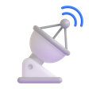 Authors

- **Rohith Prem S**, Department of Computer Science and Engineering, Saveetha
  Engineering College, <rohithprem91@gmail.com>
- **Dr. R. Selvakumar**, Department of Artificial Intelligence and Machine
  Learning, Saveetha Engineering College, <selvakumarr@saveetha.ac.in>

Released under the [MIT License](LICENSE).

<p align="center">
  
</p>
